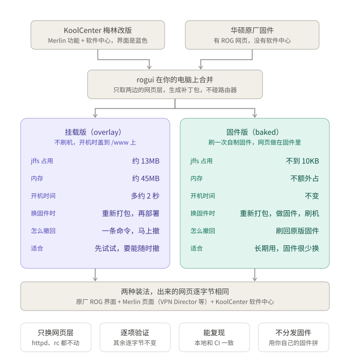

# rogui：GT-BE98 Pro 刷 KoolCenter 梅林改版后换回原厂 ROG 界面

> **English:** rogui brings ASUS's stock ROG web UI back to a GT-BE98 Pro running the KoolCenter build of Asuswrt-Merlin (3006.102). The Merlin pages (VPN Director, DNS Director, Tweaks, System Info…) and the KoolCenter Software Center keep working; only the web layer changes. The merged UI is built on your computer from two firmware files you download yourself. There are two ways to put it on the router: **overlay mode** (default) bind-mounts it over `/www` at boot and leaves the firmware untouched; **baked mode** (experimental) builds it into the KoolCenter firmware image, which you then flash, so almost nothing is kept in jffs. Prebuilt baked firmware for some KoolCenter versions is on the [Releases](https://github.com/eric1932/rogui/releases) page. Docs are in Chinese.



KoolCenter 梅林改版（3006.102 分支）没有 ROG 皮肤，界面是普通的蓝色华硕界面。rogui 把原厂 ROG 网页和 KoolCenter 的网页合在一起：

- 菜单按原厂的顺序排。Merlin 的页面插进原厂对应的菜单里，System Info 和软件中心放在最后。
- 原厂有、KoolCenter 界面里没有的页面回来了：Game Dashboard、游戏探测雷达、WiFi 雷达、WTFast、设备加速器。
- 软件中心照常能用，皮肤自动切成 ROG 版。
- 原厂的 VPN Fusion（含 Surfshark、NordVPN 一键登录）换成了 Merlin 的 VPN 页面，因为原厂那套要调用 KoolCenter 后端没有的接口。
- 修了原厂首页和 Game Dashboard 上频段图标的一个 bug。原厂把各个主网络的频段掩码相加，两个网络带同一个频段位时会进位，冲掉别的位，结果 6G 在发、图标却是灭的。rogui 改成了按位或。

只换网页层，httpd、rc 和软件中心后端都还是 KoolCenter 的。菜单逐项的差别见 [MENU-COMPARE.md](MENU-COMPARE.md)。

## 选哪种方案

两种方案出来的网页完全一样，区别只在怎么放到路由器上：

| | 挂载版（overlay，默认） | 固件版（baked，实验性） |
|---|---|---|
| 做法 | 开机时把补丁包盖到 `/www` 上，固件不动 | 把合好的网页做进 KoolCenter 固件，刷这个固件 |
| jffs 占用 | 约 13MB | 不到 10KB |
| 内存和开机时间 | 约 45MB，开机多约 2 秒 | 不额外占 |
| 换 KoolCenter 固件时 | 重新打包，再部署 | 重新打包，做固件，再刷机 |
| 撤回 | `rogui.sh stop`，马上变回蓝色 | 刷回 KoolCenter 原版固件 |
| 适合 | 先试试，要能随时撤 | 长期用，固件很少换 |

拿不准就先用挂载版，以后随时可以换成固件版。固件版可以直接下载 [Releases](https://github.com/eric1932/rogui/releases) 里做好的固件，也可以自己做。目前只在 KoolCenter 102.8_0 上实际刷过。

## 需要

- **GT-BE98 Pro**（固件里的型号是 `GT-BE98_PRO`；不带 Pro 的 GT-BE98 不行），已经刷了 KoolCenter 梅林改版。测过 KoolCenter 102.7_2、102.8_0，原厂 102_39386、102_39441。
- 路由器开了 ssh 和 jffs 自定义脚本（KoolCenter 默认开）。
- 电脑上有 `bash` 和 `python3`，只用标准库，不用装别的。在 macOS 上测过；Windows 可以试 WSL，没测过。固件版另有要求，见「固件版」。
- 仓库根目录下放两个固件文件：
  - 你刷的那版 KoolCenter 固件 `.pkgtb`；
  - 华硕官网 GT-BE98 Pro 支持页下载的原厂固件 `FW_GT-BE98_Pro_*.zip`，用来提取 ROG 网页。有多个时默认用文件名最新的那个。

直接下载 Releases 里做好的固件的话，只需要前两条。

## 安装（挂载版）

首次安装和每次升级 KoolCenter 固件之后，都是这两步。把 `admin@192.168.50.1` 换成你的管理员账号和路由器地址。

```sh
ROUTER=admin@192.168.50.1 rogui/update.sh <KoolCenter 固件.pkgtb>
cat rogui/dist/rogui-<版本>.tgz | ssh admin@192.168.50.1 'tar xzf - -C /jffs && sh /jffs/rogui/rogui.sh install'
```

1. 第一行在电脑上拆固件、打补丁包、做静态检查，大约 30 秒，不碰路由器，可以在刷机之前做。
   - 显示 ✅ 时会打印第二行的完整命令，复制去跑；
   - 显示 ⚠️ 时**不要部署**。失败的包和检查报告在 `rogui/dist/failed/`，可以附上报告提 issue。
2. 第二行把包解到 `/jffs/rogui/`，在 `/jffs/scripts/services-start` 加开机自启、在 `service-event-end` 加补回钩子，然后启用。重复执行没有影响。最后一行应该有「已启用 ROG 网页」。
3. 浏览器按 Cmd+Shift+R（Windows 是 Ctrl+F5）强制刷新，因为路由器给 CSS 设了 1 小时缓存。左侧菜单如果没变，退出再登录一次：菜单缓存在浏览器的 sessionStorage 里。

## 日常

开机自动启用，不用管。

```sh
sh /jffs/rogui/rogui.sh status      # 看状态
sh /jffs/rogui/rogui.sh stop        # 立刻回到蓝色界面（重启后会再启用）
touch /jffs/rogui/disable           # 开机不再启用；删掉这个文件即恢复
sh /jffs/rogui/rogui.sh uninstall   # 去掉开机自启和钩子，并停用
```

下面几条两种方案都适用：

- 补丁包只对**一版** KoolCenter 固件有效，升级固件后要用新固件重新打包。
- 升级固件请在网页上手动上传，不要用「检查更新」或在线升级：KoolCenter 换进来的是原厂的检查脚本，会拿原厂版本号比对，可能引导你刷回原厂。
- 不要导入原厂固件导出的 `.CFG` 配置文件：导入会绕过 httpd 的 nvram 白名单。

## 固件版（实验性）

固件版把合好的网页直接做进 KoolCenter 固件：jffs 里只剩 `rogui.sh`，开机不用复制和挂载。代价是每换一版固件都要重做一次，撤回要刷回原版固件。为什么只动了网页、怎么证明的，见「原理」。

### 直接下载做好的固件

[Releases](https://github.com/eric1932/rogui/releases) 里每个 Release 对应一版 KoolCenter 固件，名字里写着版本，例如 `rogui-3006_102.8_0-20261107` 对应 KoolCenter 102.8_0。刷它等于换成那一版 KoolCenter，再加上 ROG 网页。这些固件是 GitHub Actions 按下面「自己做固件」的流程做的，逐项对比报告附在 Release 说明里；不是 KoolCenter 或华硕出品。

1. 下载 `*-rogui-*.pkgtb`、同名的 `.sha256` 和补丁包 `rogui-*.tgz`，放在同一个目录，核对 sha256：`shasum -a 256 -c *.pkgtb.sha256`（Linux 用 `sha256sum -c`）。
2. 网页上「系统管理 → 固件升级」，手动上传这个 `.pkgtb`。
3. 部署补丁包：`cat rogui-<版本>.tgz | ssh admin@192.168.50.1 'tar xzf - -C /jffs && sh /jffs/rogui/rogui.sh install'`。固件版也离不开它：`rogui.sh` 要在开机后和每次服务事件后把 `rc_support` 里的 `rog` 补回去，不然页面背景是白的（见「原理」）。`rogui.sh status` 应显示「挂载: 不需要（固件自带 ROG 网页）」。
4. 确认没问题后，可以删掉 `/jffs/rogui/overlay.tgz` 省出 jffs，固件版用不到它。

撤回和救砖，见下面「自己做固件」的第 5 步。

### 自己做固件

做固件要在 Linux 上用 root 跑，因为解包和重新打包时要原样保留属主和设备文件，macOS 做不到；还要装 `squashfs-tools`。没有 Linux 可以用 Docker 或 GitHub Actions。

1. 照「安装」第一步打好补丁包。
2. 做固件，三选一：
   - Linux：`sudo rogui/bake.sh <KoolCenter 固件.pkgtb> rogui/dist/rogui-<版本>.tgz`
   - macOS 装了 Docker：`rogui/bake-docker.sh <KoolCenter 固件.pkgtb> rogui/dist/rogui-<版本>.tgz`。两个文件都要在仓库目录里，因为容器只挂载仓库目录。
   - GitHub Actions：fork 本仓库，先在 fork 的 Actions 页面点一次启用（GitHub 对 fork 默认不跑 workflow），装好并登录 `gh`，在 fork 里跑 `rogui/ci.sh run <KoolCenter 固件.pkgtb> [原厂固件.zip]`。它把两个固件传到草稿 Release「inputs」，触发 `bake` workflow，产物放进 Release「rogui-<KoolCenter 版本>-<日期>」，再下载到 `rogui/dist/ci-<编号>/`。这两个 Release 默认都是草稿，只有你自己看得到；加 `--public`（或者设仓库变量 `ROGUI_RELEASE=public`）产物才会公开。公开就等于分发华硕和 KoolCenter 的固件，要不要这样做你自己决定。

   产物是 `*-rogui-*.pkgtb`。对比没通过时不会产出固件：Linux 和 Docker 的报告在 `rogui/dist/failed/`，GitHub Actions 的报告在那次 workflow 运行的摘要页上。
3. 网页上「系统管理 → 固件升级」，手动上传这个 `.pkgtb`。
4. 照「安装」第二步部署补丁包。`rogui.sh` 会认出固件自带 ROG 网页，不挂载，只补 `rc_support` 里的 `rog`。`rogui.sh status` 应显示「挂载: 不需要（固件自带 ROG 网页）」。刷完到部署之前，页面背景可能是白的，部署后就好（原因见「原理」）。确认没问题后，可以删掉 `/jffs/rogui/overlay.tgz` 省出 jffs。
5. 撤回：刷 KoolCenter 原版固件。之后想用挂载版，照「安装」第二步重新部署一次补丁包。

   刷坏了进不了系统：用华硕的救援模式（拔电，按住 reset 再插电）刷原版固件，见[华硕的说明](https://www.asus.com/support/FAQ/1000814)。

## 出问题怎么办

先跑 `sh /jffs/rogui/rogui.sh status`，常见问题它会直接给出警告。

| 现象 | 原因 | 怎么办 |
|---|---|---|
| 界面变回蓝色 | 固件和补丁包不配套，多半是升级了固件还没重新打包。rogui 发现不配套就跳过，所以不会坏 | 按「安装」两步重做 |
| 所有页面背景变白，横幅变成带「退出/重新启动」按钮的华硕版 | 固件重写了 `rc_support`，丢了 `rog`（见「原理」），钩子没补回 | `sh /jffs/rogui/rogui.sh ensure` 马上补回；`status` 说没有钩子时，再跑一次 `install` |
| 软件中心里有的老插件不是 ROG 样式 | aliddns、cfddns、frpc、fastd1ck、qiandao、pushplus、routerhook、serverchan 这 8 个插件，安装时判定不是 ROG 皮肤，会把自己的 ROG 样式删掉 | 启用 rogui 之后重装这个插件 |

下面这些是已知现象，不用修：

- 有几个页面的标题写错了（AdGuard、VPN 服务器、流量统计、DNS Director、Security Notification）：原厂或 Merlin 的原文件就是这样。
- 网络地图反复进入时，Console 里有一条 MutationObserver 报错：原厂 `index.asp` 自带，页面功能正常。
- 退出登录页上的青色问号框：原厂的设计图 `icon_Sec_hint.png`。
- 登录后进的是网络地图，不是 Game Dashboard：KoolCenter 删了那个判断。

## 原理

**为什么能合。** KoolCenter 和原厂来自同一份华硕源码。原厂页面用到的 199 个 ASP 函数、77 个 cgi、37 个 action_mode，在 Merlin 3006.102 的 httpd 和 rc 里几乎都有，所以大部分原厂页面搬过来就能用。少数要调用 KoolCenter 后端没有的接口，就改用 KoolCenter 的版本，例如 VPN 页面。

**补丁包怎么来。** 全在电脑上做，不用连路由器：

- `rogui/sqfs.py` 是纯 Python 的 squashfs 读取器，直接从两个固件文件里拆出 `/www`，结果和从路由器上拉下来的逐字节相同。
- `rogui/build.py` 负责合并：
  - 只打包和 KoolCenter 不一样的文件；
  - 搬过来的 Merlin 页面要按字典重新映射 `<#N#>` 编号，因为两边字典的行号不同，不映射的话文字全会错位；
  - 把 Merlin 页面和软件中心补进菜单，软件中心的接入照搬 KoolCenter 给 GT-BE96 做的 ROG 官改；
  - 补上 Merlin 页面要用、原厂 js 里没有的函数，去掉指向不存在页面的菜单项。
- `rogui/check.py` 做静态检查，只报告合并后才出现的问题：断链、后端缺的函数、后端不处理的 `.cgi`、字典编号越界。

仓库的代码里不放补丁包：包里是华硕原厂的网页文件，而且只对一版固件有效，所以由脚本从固件文件现拼。Releases 里的固件和补丁包，是 CI 用同一套脚本拼出来的。

**挂载版。**

```
开机 → rogui.sh start
  1. 算固件自带 /www 的指纹，和补丁包里记的比；不一致就跳过
  2. 复制 /www 到 /tmp/.rogui_www/www 当底板（KoolCenter 原版网页）
  3. 解开 overlay.tgz 盖上去（原厂 ROG 网页 + 补丁）
  4. mount --bind 到 /www，重启 httpd；网页起不来就自动撤回
每次服务事件后 → rogui.sh ensure
  rc_support 里的 rog 被固件重置时补回
```

- 要先把整份 `/www` 复制到内存，是因为根文件系统 squashfs 是只读的，而原厂和 KoolCenter 的内核都没开 overlayfs，没法直接叠一层上去。45MB 内存和开机多出的 2 秒就花在这里。
- 指纹不一致就跳过，保证补丁不会盖到不配套的网页上。已经在用 ROG 界面时部署了给新固件打的包，也会先保持现状，等刷好对应的固件、重启后再生效。

**`rc_support` 里的 `rog`。** 页面要看到 `rc_support` 里有 `rog` 才走 ROG 的样式，没有它背景就是白的。`rog` 由编译选项 `ROG_UI` 决定，KoolCenter 编译时没开；而且 rc 在开机时和部分服务事件（例如 `restart_net`）时会把 `rc_support` 整个重写一遍，任何文件都管不住它。所以两种方案都要靠 `rogui.sh` 在开机后（`services-start`）和每次服务事件后（`service-event-end`）把它补回去。

**固件版。**

```
KoolCenter .pkgtb
├─ FIT 包头                记着每段的位置、大小、sha256    ← 只改 rootfs 段的大小和 sha256
├─ bootfs 段               ATF、U-Boot、内核、设备树        ← 一个字节不动
└─ rootfs 段（squashfs）   /bin /lib /usr /rom …           ← /www 以外逐项相同
                           /www                            ← 换成「原版 + 补丁包」，用原参数重打 squashfs
```

- 只换 `/www`，不从源码重新编译：KoolCenter 发布的是二进制，自己编出来的不可能和它逐字节相同，那就等于换了一个固件。只换 `/www`，才能逐项证明其他部分原封不动。
- 能这样改，是因为 KoolCenter 和原厂的 `.pkgtb` 都没有签名，只有 sha256。`fwbake.py` 遇到带签名的包会直接拒绝。
- `bake.sh` 做完会把新固件重新拆开，和原包逐项对比：`/www` 以外每个文件、目录、链接、设备文件的内容、权限、属主、修改时间都要相同；`/www` 要正好等于「原版 + 补丁包」；再用另一个读取器 `sqfs.py` 直接读新固件，也要得到同样的 `/www`。全部通过才产出固件。
- 同一个补丁包总是打出逐字节相同的固件，所以结果可以复现、核对。CI 会自己重新打补丁包，包里文件的修改时间不同，所以 CI 做的固件和本地做的 sha256 不同，这是正常的。
- 刷机时，新固件写进闪存里没在用的那一组 bootfs + rootfs，下次开机从新的一组启动。jffs、设置和插件在别的分区，不受影响。
- `rc_support` 里的 `rog` 做不进固件（见上），所以固件版也要部署 `rogui.sh`。它看到 `/www` 没有挂载、配色却已经是 ROG 红，就知道是固件版，只补 `rog`。

## 开发

- 改代码之前先看 [rogui/TESTING.md](rogui/TESTING.md)：什么时候跑哪项检查、标准是什么、每道检查防的是什么。
- 最基本的一条：改了 `build.py` 等代码之后跑 `python3 -I rogui/selftest.py`，标准是「失败 0」。
- 哪些页面用 KoolCenter 版、菜单补哪些项，在 `build.py` 顶部的 `PREFER_KC`、`MENU_*` 里改。

## 说明

这不是 KoolCenter 官方出品。用了 rogui 之后界面上的问题，请在本仓库提 issue。

软件中心和梅林改版来自 [KoolCenter](https://www.koolcenter.com/)，Merlin 页面来自 [Asuswrt-Merlin](https://github.com/RMerl/asuswrt-merlin.ng)，ROG 网页来自华硕原厂固件。
